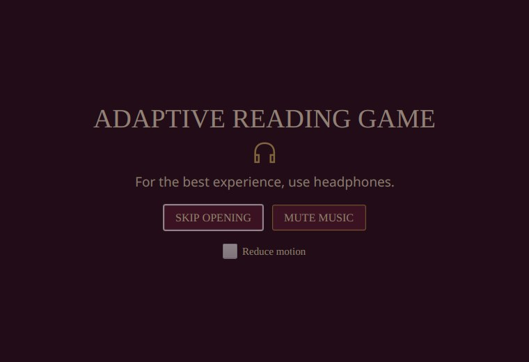
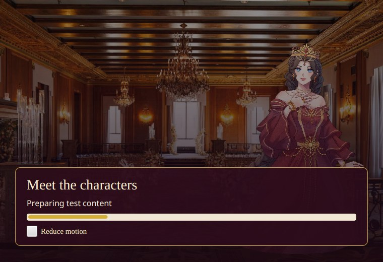
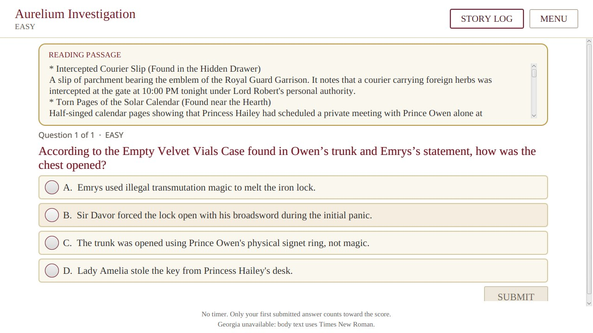
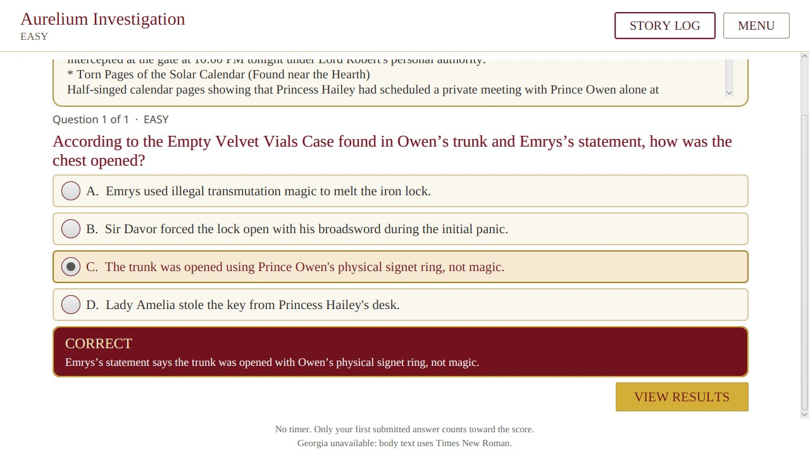
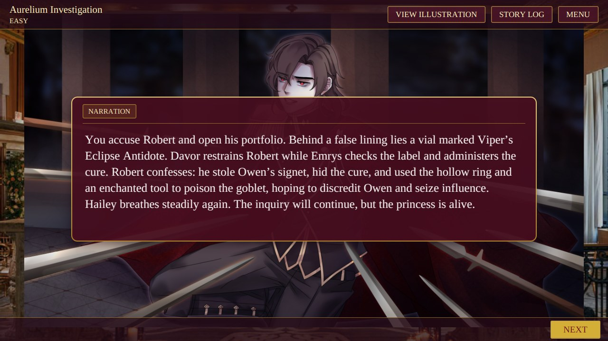
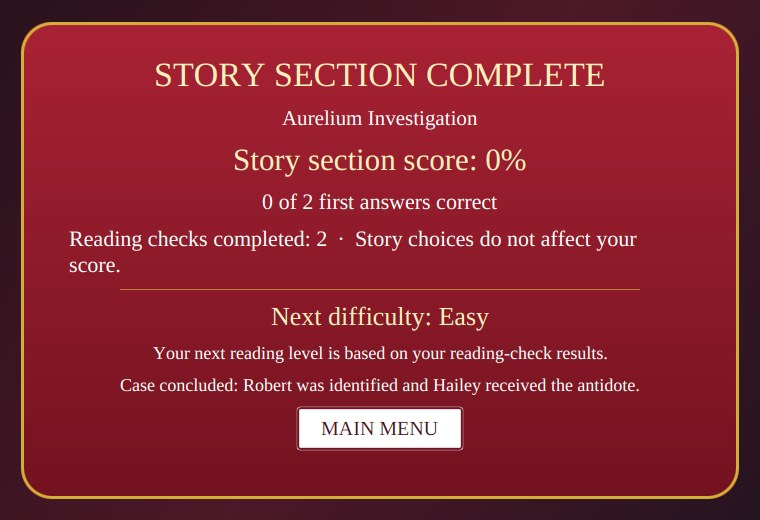
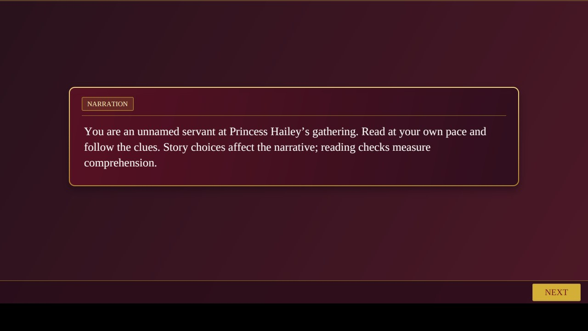
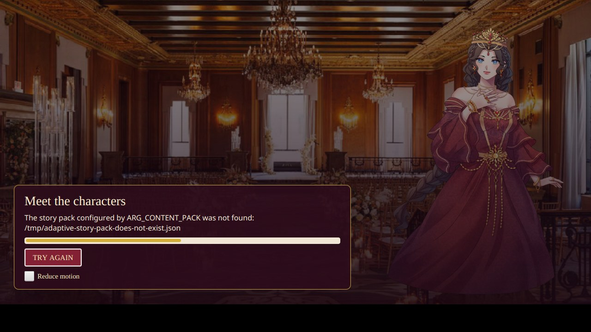

# Completed story and startup verification

The default content pack now preserves the original investigation draft and adds a separate completed chapter. The opening title now fades in more slowly, and the loading bar animates between reported startup milestones; reduced motion and Skip Opening remain available. The team-authored continuation names Lord Robert and provides four outcomes based on the player's accusation and antidote search. The story pack does not change the supplied storyboard or the original draft chapter.

The continuation and six distinct reading questions were reviewed against the supplied clues. Questions are duplicated for the route-specific checkpoint records, which yields twelve stored question entries. Each answer explanation names its supporting clue. The medium Study prompt now describes Robert's possible conflict as an inference instead of presenting his motive as proven. These editorial decisions still need group and teacher review.

## Verification

The full Maven verification passed **210 Java tests with zero failures, errors, or skips**. This included 41 JavaFX gameplay tests, two opening tests, six disposable MySQL tests, three GameAudio unit tests, three JavaFX audio-device tests, and the real Qwen model smoke test. The separate Python helper suite passed eight tests. Additional focused checks passed the four-ending small-window Robot flow and six model-policy cases, including a synthetic timeout falling back to Java.

The completed-story UI test traversed both investigation orders and their checkpoint outcomes through the account/game service, then used JavaFX Robot clicks for the accusation and antidote-search choices and opened all four endings in the actual JavaFX screens. A separate UI test selected and submitted an answer through the completed chapter's live question, feedback, and results screens. Existing Robot playthroughs also cover both full investigation orders on the unchanged draft content. The MySQL tests used a disposable local MySQL 8.4 container, ran migrations, restored an original-draft save, then saved and restored a completed-chapter checkpoint with its first answer after opening a new repository context.

The full run used Xvfb, a local audio server, the repository's pinned Qwen weights, and the disposable database. Set `ARG_TEST_DB_PASSWORD` in the terminal to a disposable test-only password before running the command. That password is not stored in the project.

```sh
MAVEN_OPTS=-Xmx256m \
ARG_MYSQL_TEST_URL=jdbc:mysql://127.0.0.1:13329/adaptive_reading_test \
ARG_MYSQL_TEST_USER=root \
ARG_MYSQL_TEST_PASSWORD="${ARG_TEST_DB_PASSWORD:?set a disposable test password locally}" \
XDG_RUNTIME_DIR=/run/user/1000 \
PULSE_SERVER=unix:/run/user/1000/pulse/native \
xvfb-run -a -s '-screen 0 1920x1200x24' mvn -B verify \
  -DargLine='-Xmx512m --enable-native-access=ALL-UNNAMED' \
  -Darg.uiTests=true \
  -Darg.mysqlTests=true \
  -Darg.modelTests=true \
  -Darg.audioDeviceTests=true \
  -Darg.ui.captureDir=target/completion-qa
```

Focused checks also passed:

```sh
XDG_RUNTIME_DIR=/run/user/1000 PULSE_SERVER=unix:/run/user/1000/pulse/native \
xvfb-run -a -s '-screen 0 1920x1200x24' mvn -B \
  -Darg.uiTests=true \
  -Darg.ui.captureDir=target/completion-layout-qa \
  -Dtest='Dev1UiTest#completedStoryChoicesReachEachEndingThroughJavaFxControls' test

mvn -B -Dtest=ModelAssistedDifficultyPolicyTest test
model-tool/.venv/bin/python -m unittest discover -s model-tool -v
```

The last Robot run verified the ending summary at the 760 by 520 minimum window with the largest reading-text setting. The report images are retained in [the gameplay captures](../qa/completed-story-2026-10-28/).
A standalone JavaFX launch under Xvfb loaded both chapters from the default completed pack. Signup, login, appearance selection, the main menu, chapter picker, instructions, and the first story screen were opened from the live application. The first story screen is shown below.















## Limits and remaining review

The JavaFX launch and Robot playthrough ran under Xvfb because no interactive desktop display was exposed in this session. They verify mouse-driven screen behavior and capture the live app, but they are not a manual playthrough on the player's physical desktop. The audio-device tests confirmed playback states, repeated clicks, pause/resume, and track changes. No human listening check was performed.

Lord Robert, the four endings, the unnamed servant, and the answer keys are team-authored decisions, not approved storyboard or teacher content. The optional model passed its response-contract smoke test and Java fallback tests; no study established that it improves reading outcomes. Windows and macOS launches were not verified.

The local Pixabay story tracks remain excluded from Git under their existing distribution restrictions. The app continues to work without them and falls back to the available investigation track when the tense track is missing.

## Startup reliability follow-up

The loading screen now accepts Space or Enter only after the ready prompt appears. A visible Retry screen reports a missing default pack or a missing or invalid `ARG_CONTENT_PACK` file. App startup no longer proceeds with no imported chapters when story content is absent.

The focused startup checks passed five tests: two story-pack path tests and three opening-screen tests. They cover default-pack missing detection, a valid override path, a missing override path, clear error text and Retry, Space and Enter blocked while final progress is animating, and entry after the prompt becomes ready.

The startup regression command was:

```sh
MAVEN_OPTS=-Xmx256m XDG_RUNTIME_DIR=/run/user/1000 PULSE_SERVER=unix:/run/user/1000/pulse/native \
xvfb-run -a -s '-screen 0 1920x1200x24' mvn -B -Darg.uiTests=true \
  -Dtest=AdaptiveReadingGameAppStartupTest,OpeningScreenUiTest test
```

The actual JavaFX app also launched under Xvfb and logged that it loaded both chapters from the default pack. Signup, login, appearance selection, main menu, chapter picker, instructions, and the first story screen opened. A separate launch with a nonexistent `ARG_CONTENT_PACK` displayed the path error and Retry; retrying displayed the same error again. This was a virtual-display check, not a manual playthrough on the user's physical desktop.


