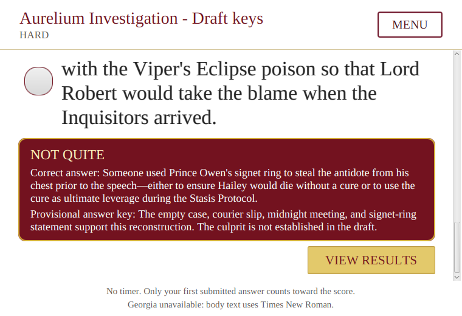

# Gameplay repair and verification, 2026-10-27

The gameplay sizing repair was tested in `59d98e8` on the `test-merge` worktree. The final commit `715e2c7` merges that tested tree with GitHub `main` at `a335ebb`. Verification was completed on 2026-10-27.

## Confirmed defects and repairs

### Illustrated scenes grew beyond the window

Entering `solarium-opening` reproduced the reported top-left cropping. The window stayed at 1280 by 720 while the gameplay area grew to 5360 by 2352 in an isolated JavaFX diagnostic. The background image took its size from the gameplay area and also contributed that size back to the same layout calculation. The repeated calculation expanded the area beyond the window.

[StoryArtworkPane](../../src/main/java/com/adaptivereadinggame/view/StoryArtworkPane.java) holds the scene background, dimmer, and illustration as decorative children. Those children no longer determine the content size. The pane crops the background to fill its viewport, keeps illustrations in proportion, and clips art at the viewport boundary. A full-illustration dialog displays the complete image without moving story progress.

The regression `illustratedViewportStaysBoundedAcrossWindowSizesAndReadingScales` waits through repeated layout updates. It checks narration, character art, an illustration, and long choices at each supported size.

### Small windows hid actions and reduced menu readability

[GameplayController](../../src/main/java/com/adaptivereadinggame/controller/GameplayController.java) places the portrait beside dialogue in a wide window and above it in a narrow window. Long story text and choices scroll vertically. The Next button stays in the footer, where it remains reachable below the scroll area.

Authentication and menu screens retain readable text while their content scrolls. Instructions, reading checks, results, and save slots also scroll when needed. The white backgrounds, serif typography, flourishes, burgundy panels, and gold borders remain consistent with the existing direction. The app continues to disclose missing-font fallbacks.

### Feedback scrolled before its new text was laid out

The reading-check screen lays out feedback before scrolling to the results action. Submitted answers remain readable, and later answers stay locked. `questionsFeedbackAndResultsFitEverySupportedSizeAndTextScale` checks full answer text and the visible results action.

Keyboard shortcuts do not intercept input while a control has focus. Holding Space advances once. A scene-level release handler clears its key state even if an asynchronous action temporarily disables the game content. The handler leaves with the gameplay scene. `heldSpaceAndFocusedNextButtonAdvanceOnlyOneNode` covers held Space, a focused Next button, and rapid taps.

## Verification evidence

The final command run was:

```sh
MAVEN_OPTS=-Xmx256m xvfb-run -a -s '-screen 0 1920x1200x24' \
  mvn -B verify \
  -DargLine='-Xmx512m --enable-native-access=ALL-UNNAMED' \
  -Darg.uiTests=true -Darg.mysqlTests=true -Darg.modelTests=true \
  -Darg.ui.captureDir=target/gameplay-qa
```

The run passed **175 Java tests** with zero failures, errors, or skipped tests. It built the application JAR, ran four MySQL integration tests against a disposable `adaptive_reading_test` database on loopback, and passed the real-model smoke test with the local helper. Eight Python helper tests passed separately.

| Check | Evidence |
| --- | --- |
| Combined Java tests and JAR | Passed. Log: `target/gameplay-final.log`. |
| Visible desktop playthrough | Passed. The mouse and keyboard route reached `draft-complete` after 204 Study-first story steps and two reading checks. Log: `target/gameplay-desktop-robot.log`. |
| Second route | Passed. The Hall-first route reached `draft-complete` after 203 story steps and two reading checks in the combined JavaFX suite. |
| Layout matrix | Four sizes: 1280 by 720, 1366 by 768, 800 by 600, and the 760 by 520 minimum. Text sizes: 0.8, 1.0, and 1.6. The story test also maximizes and restores the window. |
| Save and navigation | The minimum-size mouse test covers save, overwrite confirmation, load confirmation, settings, logout, and continuing after login. |
| Python helper contract | Eight tests passed. Log: `target/gameplay-python.log`. |
| Source whitespace | Application source and tests have no trailing-whitespace findings. The verbatim storyboard snapshot preserves source lines with trailing spaces, which `git diff --check` reports. |

The Study-first visible desktop route used mouse and keyboard input in the live JavaFX window. It did not skip story nodes through direct service calls after the chapter began. The Hall-first route used the same input-driven test under Xvfb. Layout-only cases use prepared state to reach specific screens.

The desktop screenshot service showed the live game window during the visible route. JavaFX Robot screenshots on this GNOME desktop were black; those files in `target/gameplay-desktop-qa` are not visual evidence. The following image is an automated Xvfb capture at the 760 by 520 window size. It shows submitted-answer feedback and the reachable results action.



The live desktop app is open at a story dialogue so it is ready for another manual playthrough.

## Player checks and remaining limits

Input-driven coverage includes signup validation, successful signup, login, empty Continue, chapter selection, instructions, both narrative routes, story choices, answer selection, answer locking, feedback, results, and the current draft boundary. At the minimum window size it also covers save success, overwrite and load confirmations, settings, logout confirmation, and saved Continue after login.

The MySQL tests use a disposable database, not the group's shared database. They check account persistence, first answers, route state, results, and restored state through a new application context. With MySQL settings absent, the app uses temporary in-memory storage; accounts and saves disappear when it closes.

Java owns scoring and difficulty decisions. The current story has two reading checkpoints, fewer than the three matching sections needed to call the optional model during a fresh playthrough. Controlled tests cover model eligibility, Java guardrails, fallback, and helper failure. The real-model smoke test verifies the request contract, not reading-level accuracy.

This review does not cover every story-choice combination through native desktop input or changed operating-system DPI settings. Other routes and outcomes have automated graph and service coverage. The group still needs to approve the ending and provisional answer keys. No audio or reporting features are part of this repair.
