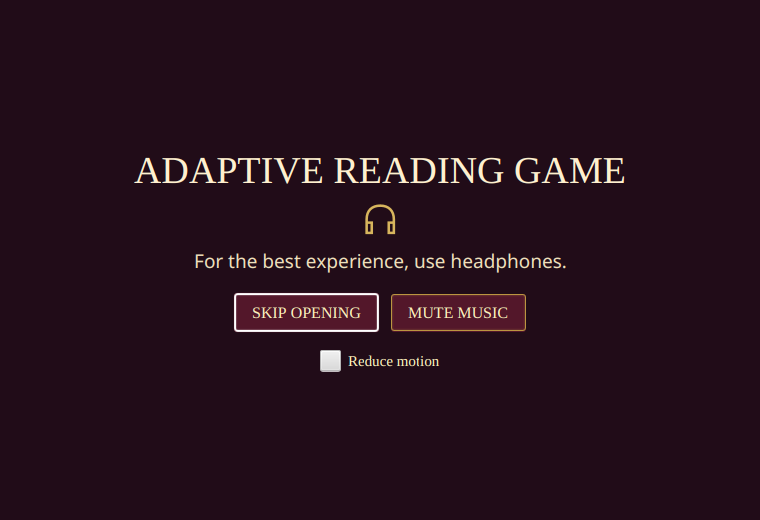
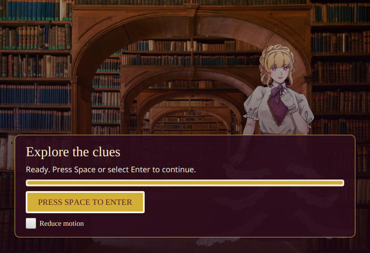
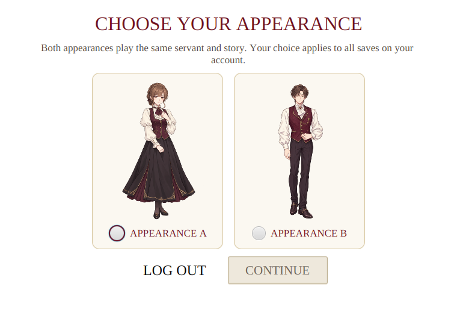
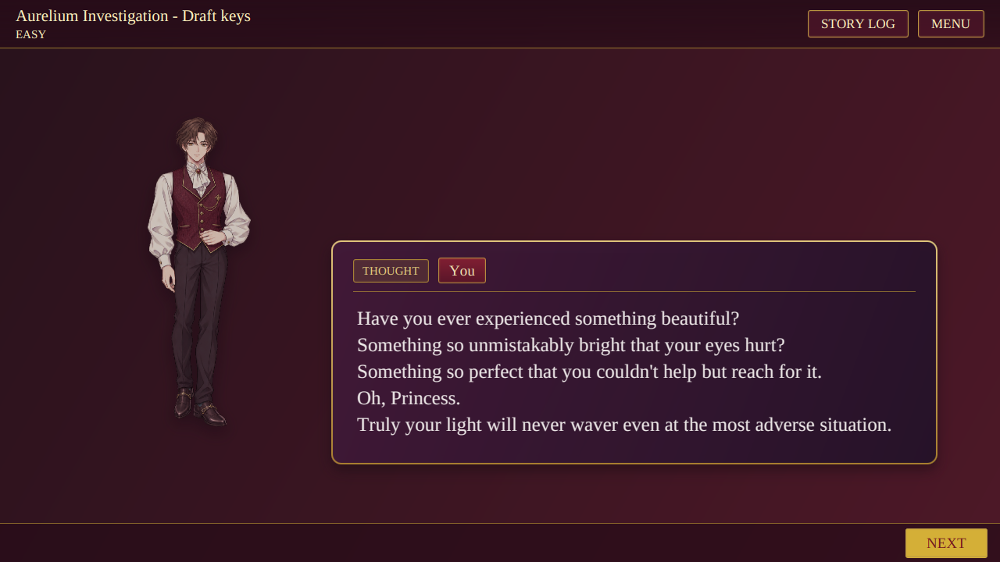
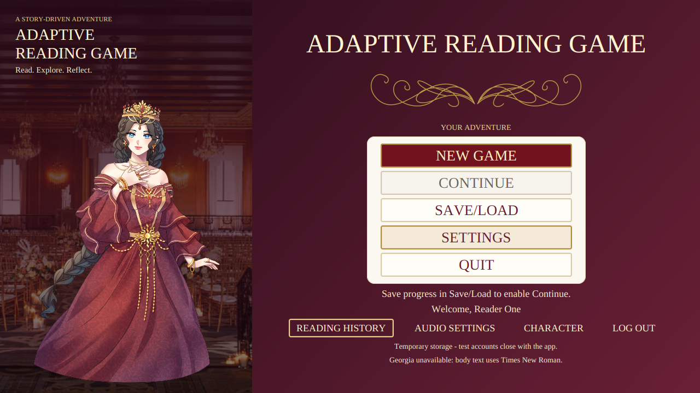

# Opening, player appearance, and audio verification

The application displays an animated text opening with a headphone recommendation, then a loading screen with rotating available artwork. The progress bar follows startup work, and Space or the Enter button opens authentication after loading succeeds. A failed startup offers Retry. Reduce Motion is available on both opening screens.

After login, an account without a selected servant appearance chooses one before reaching the main menu. The Character action can change it later. The appearance belongs to the account and applies to all its saves; it does not change the story or scores. The [player artwork record](Player-Character-Art.md) identifies the provisional generated images and their prompts.

The main menu uses a burgundy background. The supplied draft has provisional investigation and tense music cues, with silent reading checks. The two licensed Pixabay files are local and excluded from Git. Their sources, placement, and license notes are in the [asset guide](../../assets/README.md#music-and-sound-effects).

## Visual evidence

These images come from JavaFX tests under Xvfb. The loading progress screenshot uses a controlled test loader. The player dialogue uses the provisional draft.











## Verification

The full Maven verification passed 205 Java tests with no failures, errors, or skips. It included 39 gameplay UI tests, two opening UI tests, five disposable MySQL tests, three audio-device tests, and the real-model smoke test. A separate Python helper contract run passed eight tests. A later focused run passed four tests while capturing the ready and selected-servant screens.

JavaFX Robot traversed both investigation orders to the existing draft boundary. The opening tests held initialization at 25%, verified that Space could not enter early, observed the slideshow, and entered after completion. They also checked startup failure and retry. The account test selected an appearance, changed it, saved progress, signed in again, and continued with the selected portrait. MySQL tests reopened a separate application context and checked account-scoped appearance persistence.

The audio-device tests checked repeated and rapid clicks, music pause and resume, and switching between the two locally installed story tracks. The original report that clicks stopped after one use was not reproduced by the initial isolated replay test. The click playback implementation now uses independently managed players; it still needs the player's listening feedback on their own output device.

The full run used Xvfb, a disposable MySQL database, the optional local model helper, and a desktop audio server. The database password was supplied separately.

```sh
MAVEN_OPTS=-Xmx256m \
ARG_MYSQL_TEST_URL=jdbc:mysql://127.0.0.1:13318/adaptive_reading_test \
ARG_MYSQL_TEST_USER=root \
xvfb-run -a -s '-screen 0 1920x1200x24' mvn -B verify \
  -DargLine='-Xmx512m --enable-native-access=ALL-UNNAMED' \
  -Darg.uiTests=true -Darg.mysqlTests=true -Darg.modelTests=true \
  -Darg.audioDeviceTests=true -Darg.ui.captureDir=target/full-flow-qa
```

A desktop launch confirmed that the application window opened and the audio server received a Java audio stream. A separate human listening assessment and complete manual desktop playthrough were not performed. Windows and macOS audio playback were not tested. Existing MySQL installations must apply V005 as described in [database setup](../../database/README.md). The story conclusion, answer keys, player identity, and model educational quality remain subject to group review.
