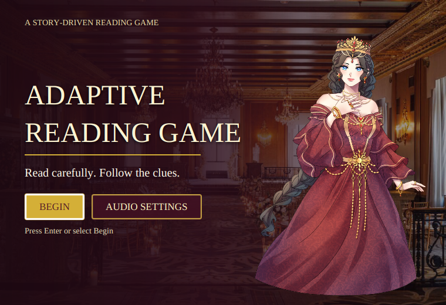
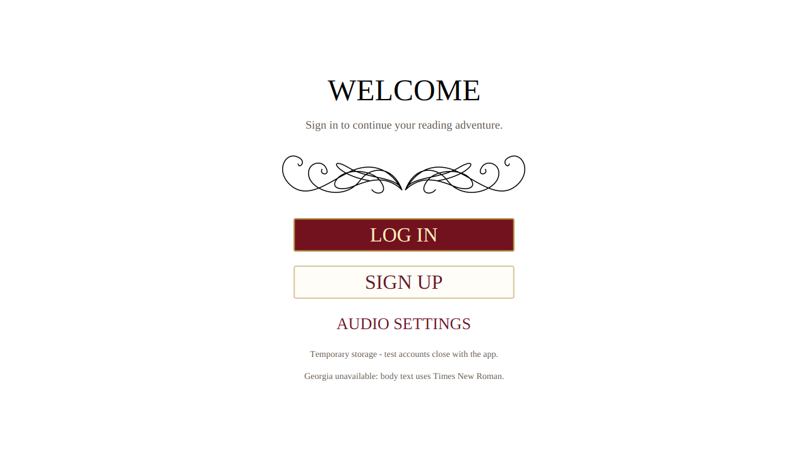
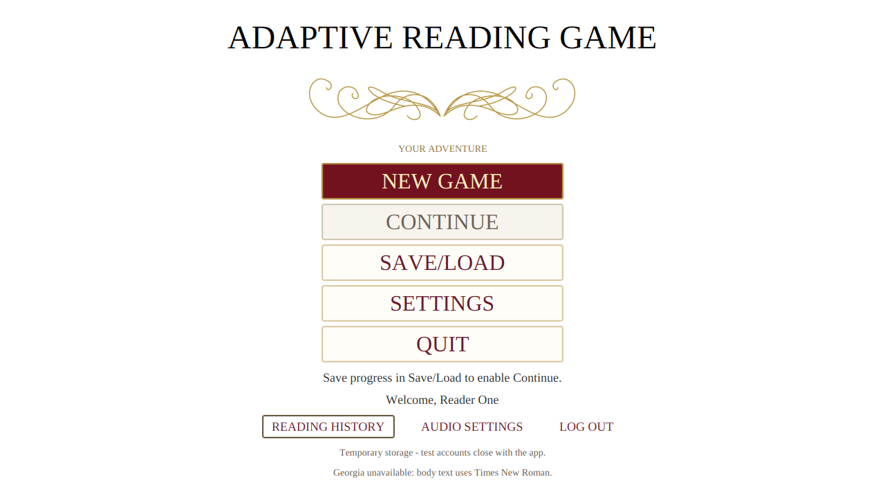

# Title screen, sound, and UI verification

The JavaFX application opens on a title screen built from the supplied palace background and Hailey artwork. Begin opens the existing account screen immediately. The welcome and main menu use white backgrounds with burgundy and gold controls. The story, questions, and unfinished ending remain provisional.

The title screen remains usable if its optional artwork is missing or unreadable. Audio Settings is available on the title screen, welcome screen, and main menu. The music attribution, sound locations, and playback behavior are in the [asset guide](../../assets/README.md#music-and-sound-effects).

## Visual evidence

These captures were produced by JavaFX tests under Xvfb. The small title screen uses the 760 by 520 minimum window size. The reading-check screenshot uses the provisional draft questions.









## Verification

The full verification run passed 191 Java tests with no failures, errors, or skips. It included 33 JavaFX UI tests, four disposable MySQL integration tests, and one real model-helper smoke test. The separate Python helper contract suite passed eight tests. The audio-device test checked music play, pause, and resume, and verified that the click reached the playing state.

JavaFX Robot traversed the Hall-first and Study-first draft routes to the existing `draft-complete` node. The routes completed two reading checks each. The title screen was checked at 760 by 520, 800 by 600, 1280 by 720, and 1366 by 768. A separate run supplied invalid scene and portrait files and confirmed the title controls remained usable. The [UI tests](../../src/test/java/com/adaptivereadinggame/ui/Dev1UiTest.java) and [audio tests](../../src/test/java/com/adaptivereadinggame/audio/JavaFxAudioOutputTest.java) define the checks.

The full run used the command below, a disposable MySQL database, the local model helper, and an available desktop audio server. The disposable database password was supplied separately.

```sh
MAVEN_OPTS=-Xmx256m \
ARG_MYSQL_TEST_URL=jdbc:mysql://127.0.0.1:13318/adaptive_reading_test \
ARG_MYSQL_TEST_USER=root \
xvfb-run -a -s '-screen 0 1920x1200x24' mvn -B verify \
  -DargLine='-Xmx512m --enable-native-access=ALL-UNNAMED' \
  -Darg.uiTests=true -Darg.mysqlTests=true -Darg.modelTests=true \
  -Darg.audioDeviceTests=true -Darg.ui.captureDir=target/final-game-redesign
```

The WAV click has a measured root-mean-square sample level of 5,171, compared with 1,795 for the previous generated click. The default effects volume is 0.55. A separate [click-level regression](../../src/test/java/com/adaptivereadinggame/audio/GameAudioTest.java) passed after the full run and checks that the asset remains above a minimum level without clipping. Perceived loudness depends on the computer and the player's audio settings.

A separate desktop launch confirmed that the application window opened and the audio server received a Java audio stream. No separate manual playthrough or human listening assessment was completed for this revision. Windows and macOS playback were not tested. The final story, answer keys, and model educational quality still require review.
