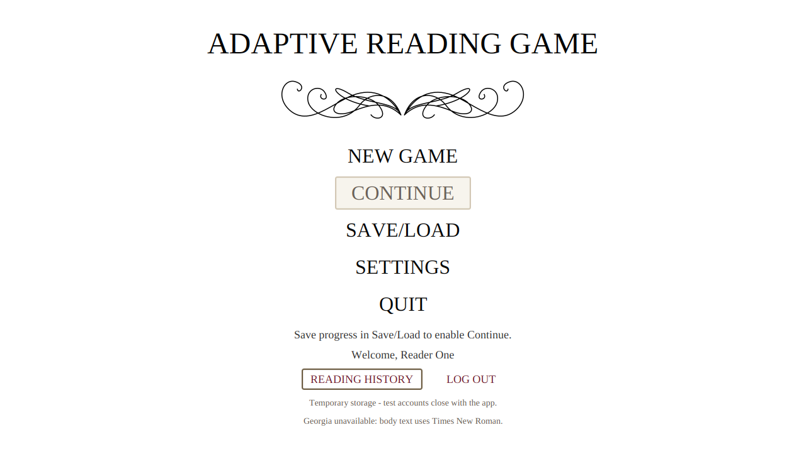
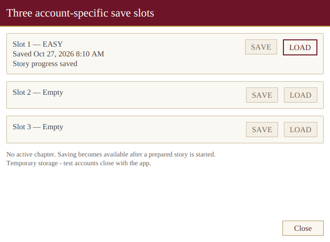
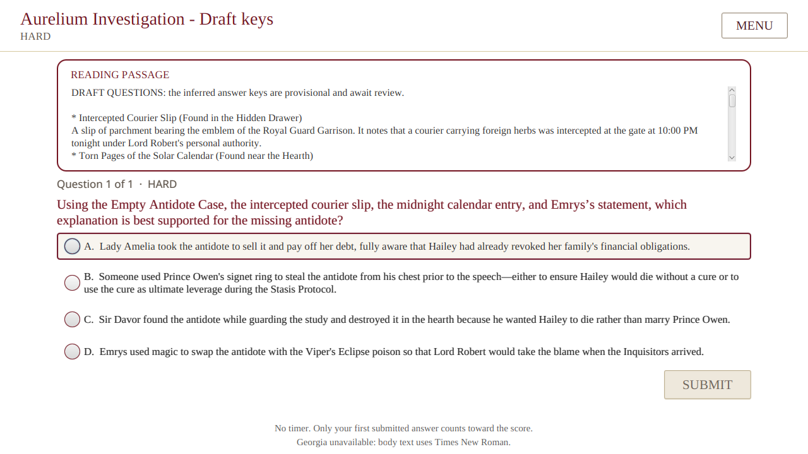
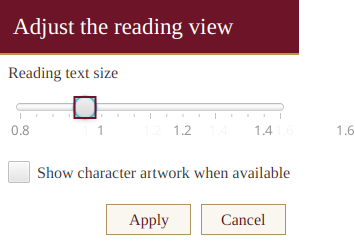

# Runtime UI accessibility and consistency QA, 2026-10-27

The runtime UI now explains why Continue is unavailable, keeps disabled actions readable, and shows consistent keyboard focus. The JavaFX screens retain the existing white, serif, burgundy, and gold style. No story content, scoring, difficulty, save format, database behavior, or AI behavior changed.

## Changes

- The main menu explains how to enable Continue and what Continue will resume.
- Disabled Continue, Submit, Save, and Load controls retain readable text. UI tests check at least 4.5:1 text contrast against each disabled control's background.
- Account fields use their visible Username, Display name, and Password labels as JavaFX label targets. The Reading text size label targets its slider.
- Each save and load action has a slot-specific accessible name and help text. Populated slots show a player-readable progress description instead of an internal story-node ID.
- Account actions, reading answers, settings controls, and dialog buttons show a burgundy or brown keyboard-focus outline.
- The Submit button explains that a player must choose an answer before submitting, then updates its help text when an answer is selected.

## Files changed

- Controllers: `AccountController.java`, `GameplayController.java`, and `MenuController.java`.
- Runtime views: `account.fxml`, `main-menu.fxml`, and `application.css`.
- UI regression coverage: `Dev1UiTest.java`.
- Project indexes: `README.md` and `Dev1-Handoff.md`.
- QA evidence: this report and four screenshots under `docs/qa/accessibility/`.

## Verification

The final command ran `mvn -B verify` under Xvfb with the disposable MySQL test database enabled. It passed 175 Java tests with zero failures, zero errors, and one skipped test. The optional Qwen model smoke test was skipped because the local helper service was not running. The run passed four MySQL integration tests and 26 JavaFX UI tests. A subsequent complete `Dev1UiTest` run passed all 26 JavaFX tests after the authentication focus assertion was added.

The UI tests covered 1280 by 720, 1366 by 768, 800 by 600, and 760 by 520 windows. Reading text scales were 0.8, 1.0, and 1.6. Input-driven checks used JavaFX Robot for menu tab order, reading-answer focus, settings keyboard controls, save/load actions, and both investigation routes. Both routes reached the existing `draft-complete` node.

The screenshots below are Xvfb scene captures from the final passing run. They show the disabled Continue explanation, keyboard focus in Save/Load, keyboard focus on a reading answer, and keyboard focus on settings controls.









The full test log is `target/ui-accessibility-verified.log`, which Maven excludes from Git. The test command and disposable database setup were:

```sh
MAVEN_OPTS=-Xmx256m \
ARG_MYSQL_TEST_URL=jdbc:mysql://127.0.0.1:13318/adaptive_reading_test \
ARG_MYSQL_TEST_USER=root \
ARG_MYSQL_TEST_PASSWORD='your-disposable-test-password' \
xvfb-run -a -s '-screen 0 1920x1200x24' mvn -B verify \
  -DargLine='-Xmx512m --enable-native-access=ALL-UNNAMED' \
  -Darg.uiTests=true -Darg.mysqlTests=true -Darg.modelTests=false \
  -Darg.ui.captureDir=target/ui-accessibility-verified
```

The password placeholder must be replaced with a disposable local test value. The test database container is stopped after verification.

## Limits

The tests verify JavaFX accessible names, label targets, keyboard focus, contrast, wrapping, and reachability. They do not certify use with an installed screen reader. The screenshots come from Xvfb, not a live desktop screenshot. Georgia remains unavailable in this environment, so the app continues to display its existing Times New Roman fallback notice.
