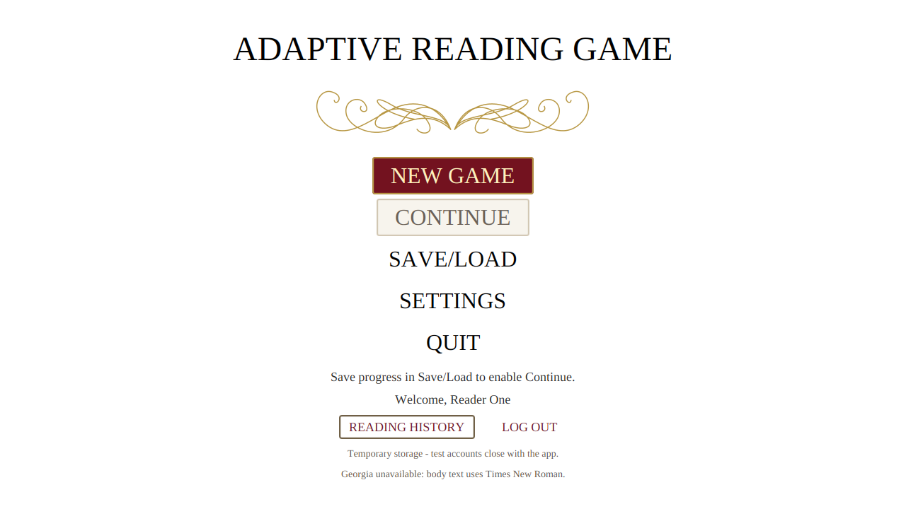
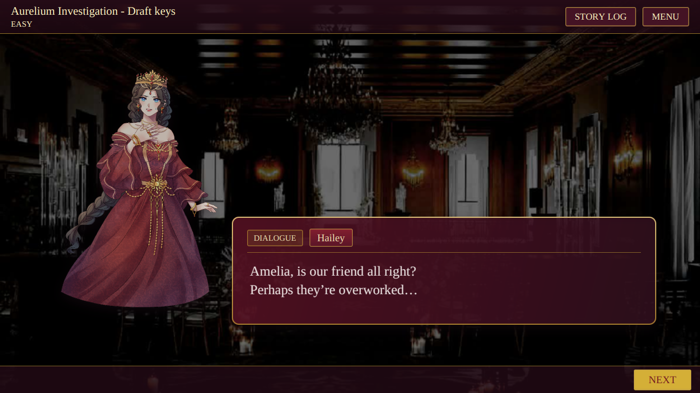
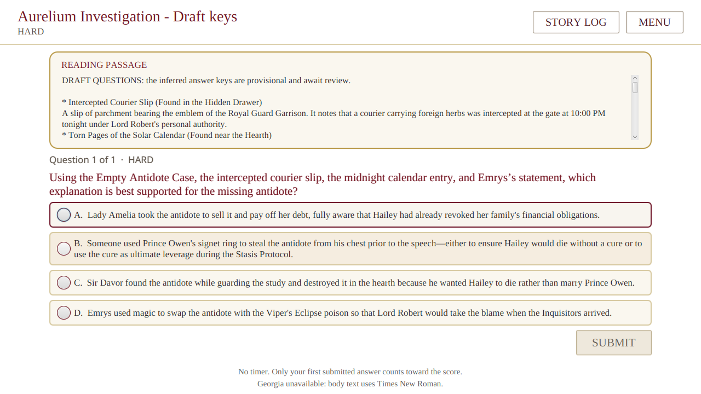
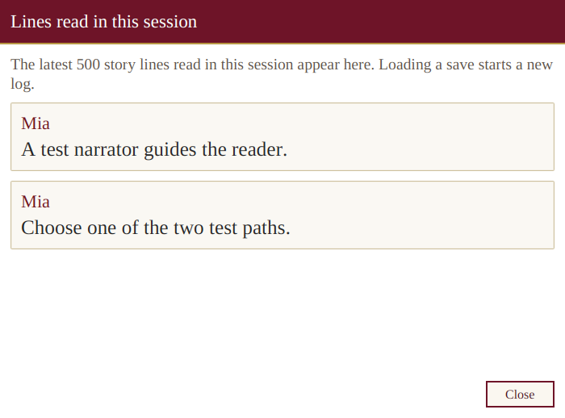
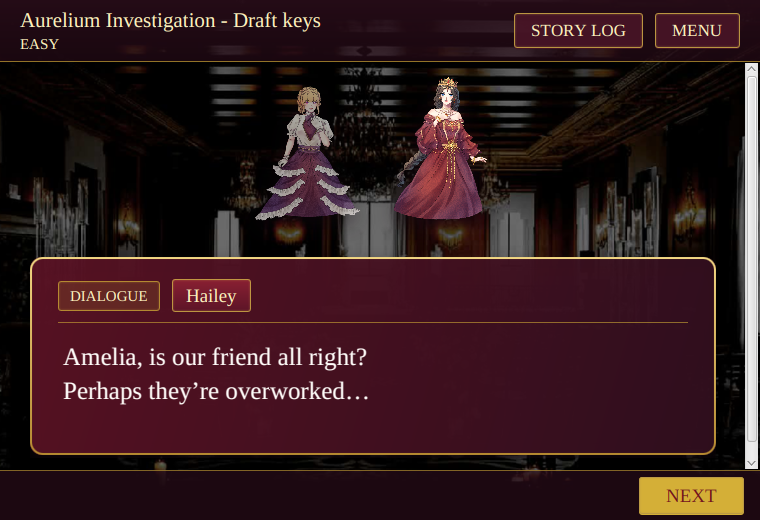
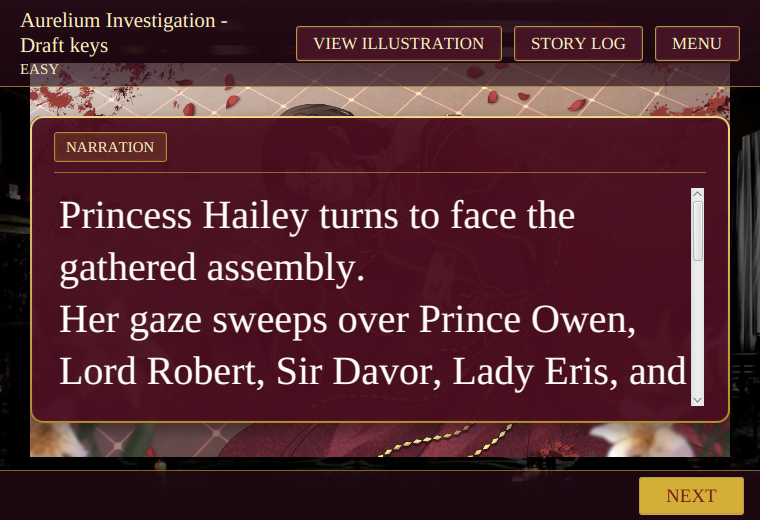
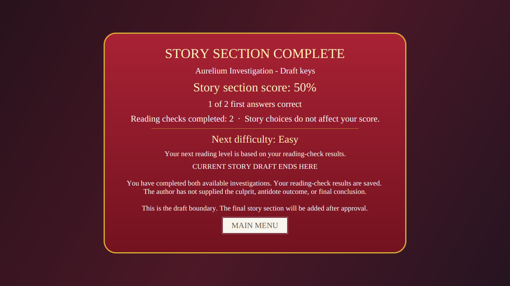

# Visual-novel player experience and QA, 2026-10-27

The JavaFX player uses a visual-novel presentation with ivory menus, serif text, burgundy and gold panels, and group-supplied artwork. The story, questions, answer keys, and unfinished ending remain provisional.

## Player experience

- Story scenes fill the window behind a compact header and navigation controls. Character portraits and dialogue sit together on wide windows and stack at narrow widths. Artwork stays clipped to the available scene area and does not drive the window size.
- Background images keep their original proportions. Illustration scenes provide a fixed **View Illustration** action that opens the complete image. Long dialogue and choices remain reachable through scrolling.
- The main menu highlights New Game, reading checks use clearer passage and answer cards, and results explain scores and the next reading level in player-facing language.
- **Story Log** shows up to 500 previously displayed story lines from the current session. It excludes questions and answers. Starting a new chapter, successfully loading a save, or signing out clears the log; canceling a load keeps it.
- **Reduce story animations** in Settings disables scene, portrait, and dialogue transitions. Reading size, artwork visibility, and reduced motion apply to the current session.
- An optional author-supplied staging file can place one supporting character beside the active speaker. No staging cues were added to the provisional production story. See [story content and art](../../assets/README.md) for the format and fallback behavior.

Java services own first-answer scoring, narrative choices, and the final difficulty decision. The game uses authentication, MySQL, and save formats described in the [handoff](Dev1-Handoff.md). The reading flow has no audio or final conclusion.

## Visual evidence

The following captures are from automated JavaFX tests under Xvfb. The two-character picture uses a test-only staging cue; it is not a claim that the author placed those characters together in the production story.















## Verification

The final `mvn -B verify` run passed **186 Java tests**, with zero failures, errors, or skips. It included 31 JavaFX UI tests, four disposable-MySQL integration tests, and one real Qwen helper smoke test. The separate Python helper contract suite passed eight tests. The helper test confirms the integration contract, not the educational validity of the model's recommendations.

The JavaFX tests ran under Xvfb with JavaFX Robot mouse and keyboard input. The Hall-first path reached the existing `draft-complete` node after 203 story steps and two reading checks; the Study-first path reached it after 204 steps and two checks. The tests cover answer selection and first-answer locking, feedback, results, Story Log, reduced motion, navigation, save/load, the illustration dialog, and author-provided staging fixtures. MySQL tests checked accounts, first answers, results, and restored saves through new application contexts against a disposable local database.

Layout checks covered 1280 by 720, 1366 by 768, 800 by 600, and 760 by 520 windows at reading scales 0.8, 1.0, and 1.6, as well as maximize and restore. A regression checks that the illustrated viewport remains bounded through layout pulses. Another checks that visible header actions fit their full labels and remain inside the window. Robot opened the illustration dialog at the minimum size.

The coverage is defined by [the JavaFX UI tests](../../src/test/java/com/adaptivereadinggame/ui/Dev1UiTest.java), [the MySQL integration tests](../../src/test/java/com/adaptivereadinggame/repository/mysql/MySqlGameRepositoryIntegrationTest.java), and [the model smoke test](../../src/test/java/com/adaptivereadinggame/ai/QwenModelSmokeTest.java).

The final command used the same disposable database and optional helper services described above:

```sh
MAVEN_OPTS=-Xmx256m \
ARG_MYSQL_TEST_URL=jdbc:mysql://127.0.0.1:13318/adaptive_reading_test \
ARG_MYSQL_TEST_USER=root \
xvfb-run -a -s '-screen 0 1920x1200x24' mvn -B verify \
  -DargLine='-Xmx512m --enable-native-access=ALL-UNNAMED' \
  -Darg.uiTests=true -Darg.mysqlTests=true -Darg.modelTests=true \
  -Darg.ui.captureDir=target/vn-final-verified
```

The disposable test password was supplied separately. Run the helper contract suite with `model-tool/.venv/bin/python -m unittest discover -s model-tool -v`.

## Limits and remaining group input

- The final pass was automated under Xvfb. A separate physical desktop playthrough of this exact revision was not performed in this session.
- The ending, culprit, final question wording, and answer keys still need group approval. The supplied reveal illustration remains unused until its story placement is approved.
- The production draft contains no approved supporting-character stage cues. The two-character example above is a test fixture only.
- Story Log and Settings preferences are session-only. Loading a save starts a new log rather than restoring earlier dialogue.
- Georgia was unavailable in the test environment. The app announced a Times New Roman fallback. Font availability may differ on another computer.
- Screen-reader use and the educational accuracy of the model have not been independently validated.
