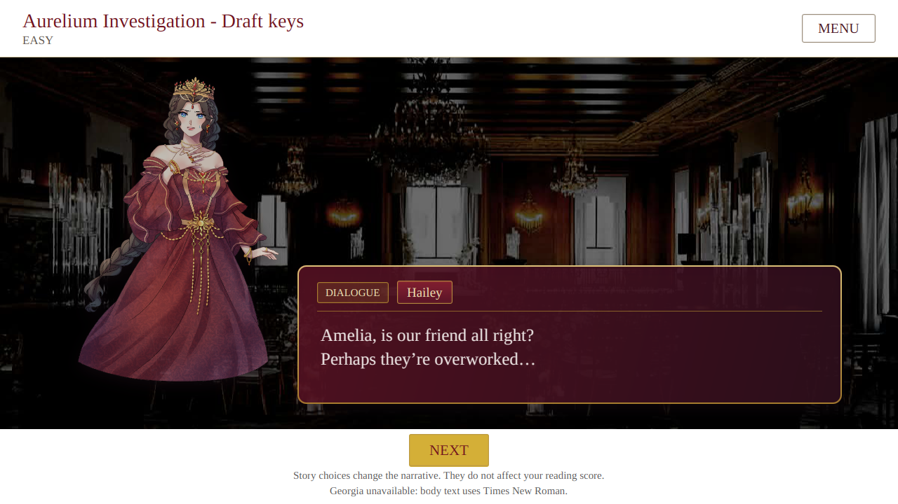
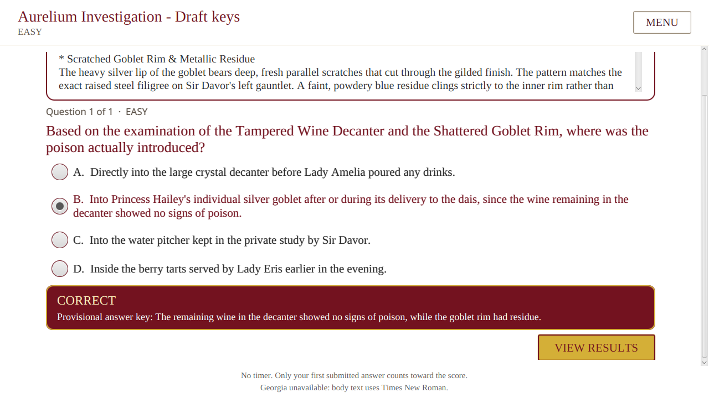
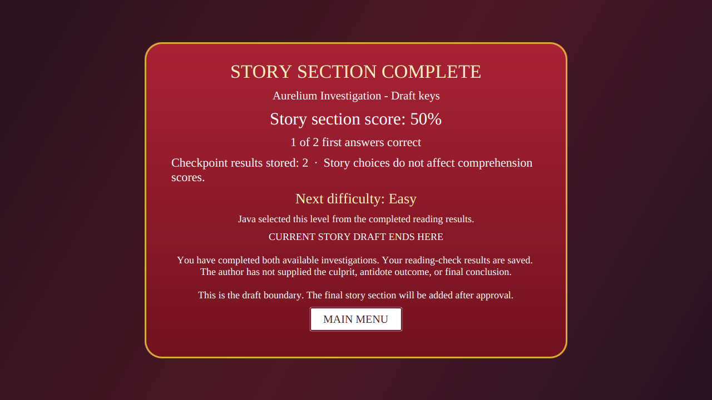
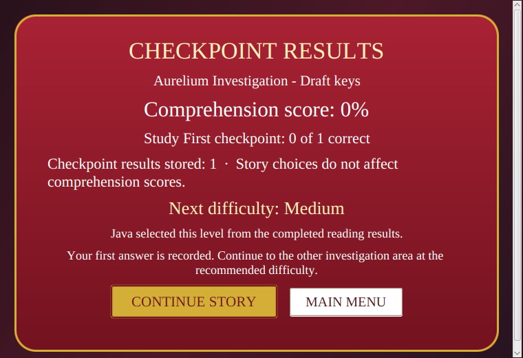

# Gameplay visual polish and verification, 2026-10-27

This report records the visual update layered onto the existing Adaptive Reading Game. It keeps the project's white menus, serif typography, burgundy story panels, gold borders, and supplied character and scene artwork. The dialogue stage now uses broader visual-novel presentation cues: a full-height character over the scene, a nameplate inside the dialogue panel, a darker layered panel, and brief transitions when the speaker or line changes. The inspiration is general; the application uses its own group-provided assets, content, and theme rather than Heaven Burns Red artwork or branding. See the [official Heaven Burns Red system gallery](https://kr.heaven-burns-red.com/system/) for the reference point.

## What changed

- Enlarged the transparent character cutout on the story stage and removed the pale portrait card so the character sits over the background.
- Moved the speaker name into the dialogue panel beside a small narration, dialogue, or thought label.
- Added a restrained burgundy gradient, antique-gold edge, soft shadow, italic thought presentation, and short fades for dialogue and character changes.
- Kept the scene dimmer lighter, added a more distinct treatment for story choices, and aligned the results screen with the same burgundy palette.
- Cached character images and sized the dialogue viewport to keep short lines compact while allowing longer passages to scroll.
- Kept the footer actions reachable and retained the side-by-side character/dialogue layout at wide widths, with a stacked layout at narrow widths.
- Updated the input-driven MySQL UI fixture to use a unique chapter title on each run. This prevents old fixture rows in the disposable test database from making the test select a chapter created by an earlier run.

The change is limited to `GameplayController`, `gameplay.fxml`, `application.css`, the focused JavaFX test, this report, and the QA screenshots. It does not change scoring, difficulty decisions, save behavior, question wording, answer keys, or story outcomes.

## Current resource coverage and story boundary

The draft references 27 distinct character asset keys, all three supplied scene backgrounds, and the `cg-poisoning` illustration. The repository contains 37 character PNGs and two CG images. Ten character files are not referenced by the current draft, so they remain unassigned rather than guessing which line or emotion they belong to. The `cg-killer-caught` reveal image remains unused because it belongs to the unapproved conclusion.

No conclusion or new story content was invented. Both investigation orders still stop at the existing `draft-complete` node, where the results screen says the author has not supplied the culprit or final conclusion. Audio remains out of the player flow. In this environment Georgia is unavailable; the app explicitly displays its Times New Roman fallback notice.

## Visual evidence

The images below are clean JavaFX captures from the completed UI test run. They show the dialogue stage, a submitted comprehension answer, the explicit draft boundary, and the minimum-size results layout.









## Verification

The final verification command was:

```sh
MAVEN_OPTS=-Xmx256m \
ARG_MYSQL_TEST_URL=jdbc:mysql://127.0.0.1:13318/adaptive_reading_test \
ARG_MYSQL_TEST_USER=root \
xvfb-run -a -s '-screen 0 1920x1200x24' mvn -B verify \
  -DargLine='-Xmx512m --enable-native-access=ALL-UNNAMED' \
  -Darg.uiTests=true -Darg.mysqlTests=true -Darg.modelTests=true \
  -Darg.ui.captureDir=target/final-published-visual
```

`ARG_MYSQL_TEST_PASSWORD` was supplied separately as a disposable local test credential and is intentionally not recorded here.

It passed **175 Java tests** with zero failures, errors, or skipped tests. The 26 JavaFX tests include mouse and keyboard player input, both investigation orders, answer selection and feedback, save/load navigation, layout checks, and the MySQL-backed assessment-resume flow. The test exercised 1280 by 720, 1366 by 768, 800 by 600, and 760 by 520 windows at 0.8, 1.0, and 1.6 reading-text scales, then maximized and restored the window. Four MySQL integration tests and the opt-in real-model smoke test also passed.

The Hall-first route reached `draft-complete` after 203 story steps and two reading checks. The Study-first route reached the same boundary after 204 steps and two checks. These routes used JavaFX Robot mouse and keyboard actions under Xvfb; they are automated input-driven results, not a claim that a teacher-approved conclusion exists.

The application was also opened on the actual desktop and the illustrated dialogue screen was visually checked. It is left open for a manual retest. That desktop check confirmed launch and presentation only; the complete route traversal above was performed by the automated JavaFX UI tests. Earlier gameplay repair evidence remains in [gameplay repair and verification, 2026-10-27](Dev1-Gameplay-QA-2026-10-27.md).
