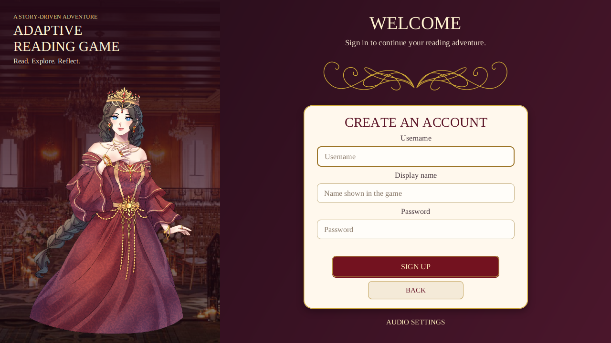
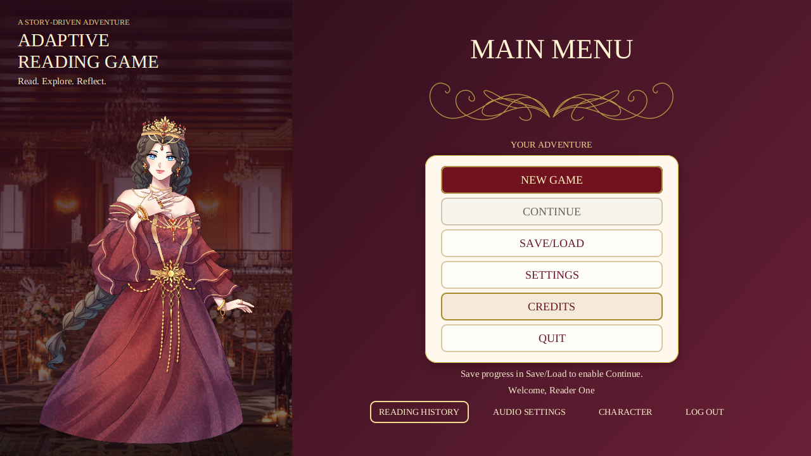
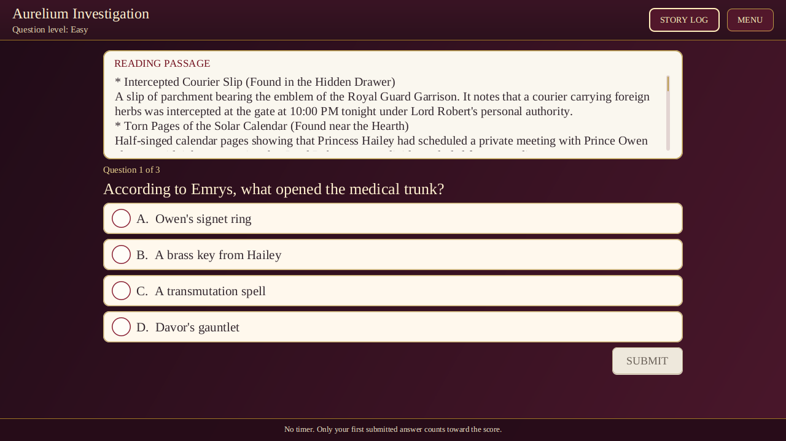
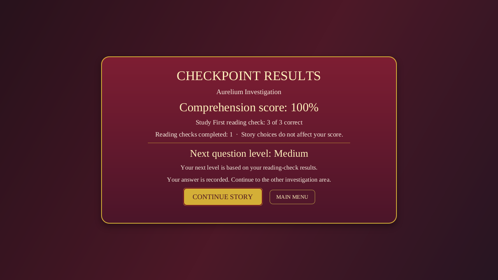

# Integration verification

The current branch passes the automated Java, JavaFX, MySQL, and model-helper checks listed here. The checks ran on Fedora 44 with Maven 3.9.11 and JDK 25.0.4. The project compiles for Java 21.

## Automated checks

The full Maven verification passed 236 tests with zero failures, zero errors, and four opt-in skips. The run included 49 JavaFX gameplay tests, five opening-screen tests, and six MySQL integration tests against a disposable MySQL 8.4.11 container on loopback.

```sh
export MAVEN_OPTS=-Xmx256m
export ARG_MYSQL_TEST_URL=jdbc:mysql://127.0.0.1:13329/adaptive_reading_test
export ARG_MYSQL_TEST_USER=root
export ARG_MYSQL_TEST_PASSWORD='<disposable test password>'
export XDG_RUNTIME_DIR="/run/user/$(id -u)"
export PULSE_SERVER="unix:$XDG_RUNTIME_DIR/pulse/native"

xvfb-run -a -s '-screen 0 1920x1200x24' mvn -B verify \
  -Darg.uiTests=true \
  -Darg.mysqlTests=true \
  -DargLine='-Xmx512m --enable-native-access=ALL-UNNAMED' \
  -Darg.ui.captureDir=/tmp/adaptive-reading-game-final-check-2026-11-02
```

The four skips were the three opt-in audio-device tests and the opt-in real-model test. The separate Qwen smoke test passed one test against the bundled model and loopback helper. The Python helper suite passed eight tests. A separate JavaFX audio run passed two tests and skipped the optional story-track check because the local story tracks were absent.

The JavaFX Robot suite completed both input-driven investigation orders through their draft boundary. The content tests loaded the versioned story pack. The suite also checked account screens, the menu with and without progress, reading checks, answer feedback, results, saves, navigation, startup, and supported window sizes. It generated 80 screen captures; representative images are checked in below.

## Screen captures

These images come from JavaFX UI tests. Story and question states use the test content defined by the suite.












## Remaining checks

This run used Xvfb for screen interaction. It did not repeat a full visible desktop playthrough. The earlier Fedora walkthrough stopped at the first story screen; see [game finalization QA](Game-Finalization-QA-2026-10-30.md). Windows and macOS launch behavior has not been checked in this run.

The Xiaomi Pad 7 previously compiled and started the game through Debian PRoot and Termux:X11, but a visible device playthrough remains unverified. Alpine PRoot did not start OpenJDK 21 on that device. The tested launcher supports Debian PRoot.

MySQL tests used a disposable database. A deployment database still needs configuration through `ARG_DB_*`; without it, the app uses temporary in-memory storage. The group and teacher still need to review the new story conclusion and answer keys. The Qwen smoke test confirms its request contract, not educational quality. Teacher and parent reporting remains deferred.
